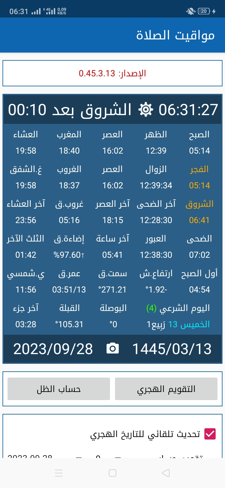
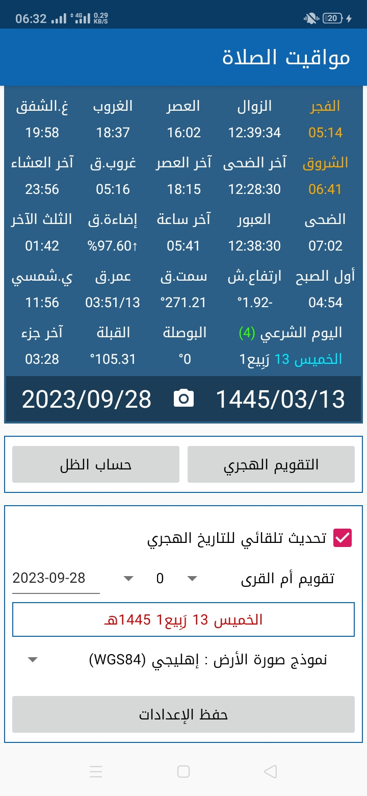
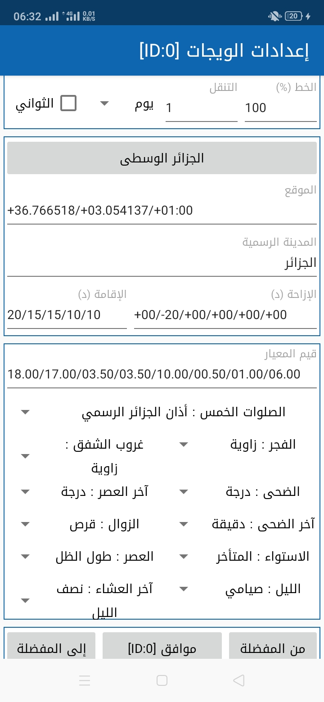
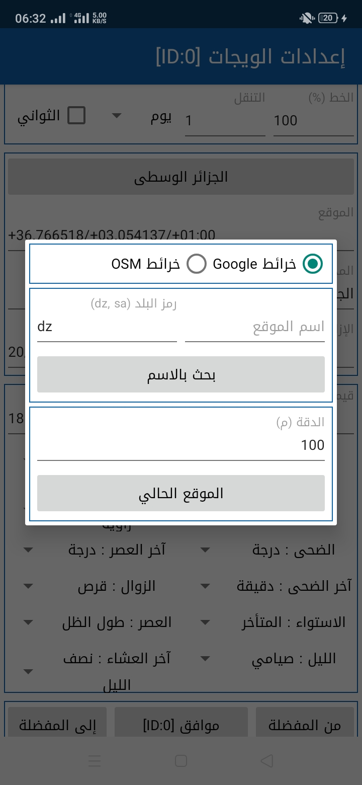
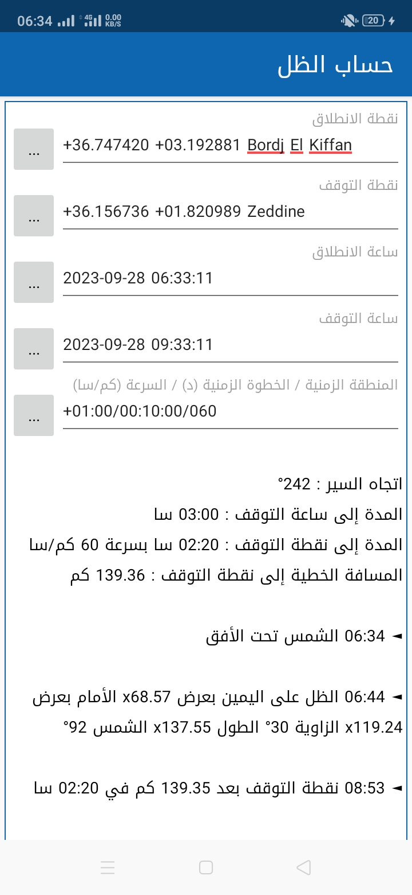

# PrayerTimes

**PrayerTimes** is a public-domain application that provides prayer times.

## Screenshots :

|  |  |  |  |  |  |
|--|--|--|--|--|--|

## TODO :

- add forceResultsForToday to get correct rise/set/transit moon times for today not yesterday or tomorrow
when timezone is different then UTC.
search forceResultsForToday on http://conga.oan.es/~alonso/doku.php?id=blog:sun_moon_position

## Build

- Backup `أذان الجزائر الرسمي` using `Cx Explorer` to backup.apk
- Extract `backup.apk/base.apk/assets/mindb.db` using `7-Zip`
- Run [marw.sql](marw.sql) on it using `SQLiteStudio`
- rename it to `marw-<hyear>.db`
- Put it in [databases](app/src/main/assets/databases) 
- Update `FILE_NAME_DB_MARW` in [Constants](app/src/main/java/jalil/prayertimes/Constants.java)
- Build and release APK by running this [Workflow](https://github.com/abdeldjalil-fellah/PrayerTimes/actions/workflows/release.yml)
